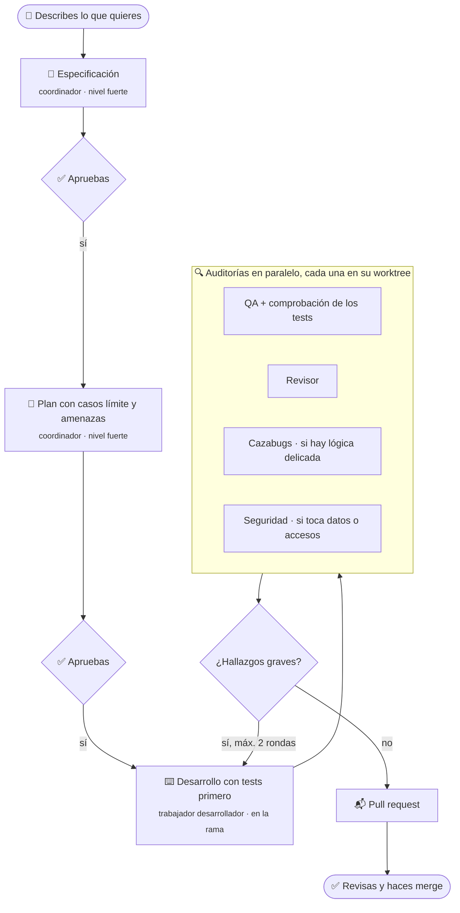

<div align="center">

# 🐟 Pilotfish

**Un equipo de desarrollo con IA, guiado por especificaciones y con varios modelos, para [Orca](https://www.onorca.dev).**

Tú apruebas la especificación y el plan. Un equipo de agentes lo construye con tests primero, lo audita y abre una pull request que mergeas tú.
Cada papel usa el modelo que *tú* eliges, con reservas automáticas cuando alguno se queda sin uso.

[](https://github.com/davidgarcia11/pilotfish/actions/workflows/validar.yml)


[English](README.md) · **Español**

</div>

---

## ¿Por qué Pilotfish?

Los agentes de programación son rápidos, pero a su aire se saltan los tests, se desvían de lo que pediste y firman sus commits. Con varios agentes en paralelo es peor: ¿quién planifica, quién revisa y qué pasa cuando tu plan se queda sin uso a mitad?

Pilotfish da a tus agentes un **proceso**, una **estructura de equipo** y **protecciones que viven en tu repositorio**, para que el resultado parezca el trabajo de un equipo sénior disciplinado, uses los modelos que uses.

> El pez piloto nada junto a la orca. Pilotfish nada junto a [Orca](https://www.onorca.dev), el entorno de desarrollo con agentes sobre el que funciona.

## ✨ Qué ofrece

| | |
|---|---|
| 📝 **Especificación primero** | No se programa nada hasta que apruebas una especificación y un plan con casos límite y amenazas. |
| 🧪 **Tests primero, comprobados** | Cada tarea lleva un test que se vio fallar antes de implementar. Después, QA rompe a propósito el código crítico para demostrar que los tests lo detectan. |
| 👥 **Un equipo de verdad** | Coordinador, desarrollador, QA, revisor, cazabugs y auditor de seguridad, cada uno con sus instrucciones. |
| 🎛️ **Tus modelos** | Eliges el modelo de cada papel en un archivo de configuración. Combina Claude, Codex, DeepSeek, GLM o cualquier agente que Orca pueda lanzar. |
| 🔁 **Reservas automáticas** | ¿Un modelo sin uso? El papel pasa al siguiente de su lista, o se pausa si prefieres no bajar de nivel. |
| 🧭 **Revisión cruzada** | El revisor prefiere un proveedor distinto al del desarrollador, así ve otros fallos. |
| 🌳 **Pensado para trabajar en paralelo** | Los auditores trabajan en worktrees aislados y cada worktree tiene sus propias bases de datos y puertos. |
| 🛡️ **Protecciones en el repositorio** | Los hooks de git y el CI bloquean secretos, exigen commits convencionales y rechazan firmas de IA, para cualquier agente y aunque se salte los hooks. |
| 🤝 **Relevo** | Todo el estado vive en el repositorio, en Orca y en el estado del worktree. Cualquier agente puede decir «continúa» y seguir donde lo dejó otro. |
| 🙋 **Tú mandas** | Apruebas en el chat (o desde el móvil con Orca Móvil). El merge siempre lo haces tú; después, el coordinador lo pone todo al día. |

## 🔄 Cómo funciona



- **El coordinador** es el agente con el que hablas en una tarea de Orca. Escribe la especificación y el plan, reparte el trabajo con la orquestación de Orca y comprueba cada resultado con evidencias.
- **Los trabajadores** son agentes que Orca lanza con el modelo que elige tu configuración. Cada encargo lleva las instrucciones completas del papel, así que cualquier proveedor puede hacer cualquier papel.
- **Las auditorías van según el riesgo:** QA y revisor, siempre; cazabugs y seguridad, solo cuando el cambio lo pide.

## 🚀 Empezar

**Requisitos** en la máquina donde corren tus agentes (por ejemplo, un servidor de Orca siempre encendido):

- [Orca](https://www.onorca.dev) con sus skills `orchestration` y `orca-cli`
- Al menos un agente con la sesión iniciada (por ejemplo [Claude Code](https://docs.claude.com/en/docs/claude-code))
- `git`, `python3` 3.11 o superior, [`mise`](https://mise.jdx.dev) y Docker para proyectos con servicios locales

**Instalación:**

```bash
gh repo clone davidgarcia11/pilotfish ~/pilotfish
~/pilotfish/bin/pilotfish install
```

Enlaza la skill `pilotfish` para tus agentes (`~/.claude/skills`, `~/.agents/skills`), deja el comando `pilotfish` en `~/.local/bin`, permite a Claude Code leer (no editar) la carpeta de Pilotfish sin preguntar, da a OpenCode las mismas prohibiciones que a Claude y te enseña qué modelo hará cada papel.

**En Orca** (Ajustes → host del servidor → Agentes): pon **Permisos** en **Aprobar por mí** y comprueba que los argumentos de Claude no incluyen `--dangerously-skip-permissions`. Orca viene con acceso total por defecto, y los trabajadores de la orquestación lo heredan.

**Uso:** abre una tarea en Orca con tu agente coordinador y di lo que quieres.

| Dices algo como… | Flujo |
|---|---|
| «Crea una app que…» | [Nuevo proyecto](skills/pilotfish/flujos/nuevo-proyecto.md) |
| «Adapta este proyecto al estándar» | [Adaptar proyecto](skills/pilotfish/flujos/adaptar-proyecto.md) |
| «Pon al día este proyecto con Pilotfish» | [Actualizar proyecto](skills/pilotfish/flujos/actualizar-proyecto.md) |
| «Añade…», «cambia…» | [Funcionalidad](skills/pilotfish/flujos/funcionalidad.md) |
| «X falla…» | [Arreglo](skills/pilotfish/flujos/arreglo.md) |
| «Continúa» | Relevo: sigue un flujo que otro coordinador dejó a medias |

**Actualizar:** el coordinador descarga la última versión de Pilotfish al empezar cada flujo y vuelve a leer sus instrucciones si han cambiado. Ejecuta `pilotfish update` tú cuando te lo pida (cambios de permisos) o cuando quieras.

## 🎛️ Elegir modelos

Cada papel pide un **nivel**, y cada nivel es una lista de modelos por orden de preferencia ([`team.toml`](team.toml)):

```toml
[tiers]
strong   = ["claude:opus", "codex:gpt-6-astra", "opencode:deepseek/deepseek-v4-pro", "opencode:zai-coding-plan/glm-5.3"]
standard = ["claude:sonnet", "codex:gpt-6.1-sol", "opencode:deepseek/deepseek-v4-pro", "opencode:zai-coding-plan/glm-5.3"]
budget   = ["opencode:deepseek/deepseek-flash", "opencode:zai-coding-plan/glm-5.3-flash", "claude:sonnet"]

[roles]
plan       = "strong"     # coordinador: especificación y plan
coordinate = "standard"   # coordinador: repartir, comprobar y abrir la PR
developer  = "budget"
qa         = "budget"
reviewer   = "standard"
bug_hunter = "strong"
security   = "strong"

[rules]
when_tier_exhausted = "pause"   # o "downgrade"
reviewer_different_provider = true
```

- **Gana el primero disponible.** Se salta un modelo si su agente no está instalado, no tiene la sesión iniciada, no ofrece ese modelo o se ha quedado sin uso. Si mañana instalas Codex, entra solo: ya está en las listas.
- **Tus cambios** van en `~/.config/pilotfish/team.toml` (lo crea `pilotfish config --template`). Pon solo lo que cambies; las actualizaciones nunca lo tocan.
- **Un papel puede tener su propia lista** en vez de un nivel, por ejemplo `security = ["claude:opus", "codex:gpt-6-astra"]`.
- **Cambios puntuales:** dile al coordinador «que la seguridad la haga Codex en esta» y lo aplica solo a esa tarea.
- **Esfuerzo por papel:** `[effort]` fija cuánto piensa cada trabajador (`low`, `medium`, `high`); los papeles que no pongas usan `default` (`medium`). Cuenta en los trabajadores de Claude, y más esfuerzo es más consumo. El esfuerzo del coordinador es el de la pestaña que abres tú en Orca.

Una configuración personal que desarrolla con DeepSeek V4 Pro y ahorra uso en QA:

```toml
# ~/.config/pilotfish/team.toml
[roles]
developer = ["opencode:deepseek/deepseek-v4-pro", "opencode:deepseek/deepseek-flash", "claude:sonnet"]

[effort]
qa = "low"
```

Cada línea pertenece a la `[sección]` que tiene encima: `qa = "low"` debajo de `[roles]` significaría «QA usa un nivel llamado low». La plantilla comentada que crea `pilotfish config --template` lista todas las opciones.

Para ver qué usará cada papel ahora mismo:

```console
$ pilotfish agents
Role         Tier      Uses                                       Fallbacks
plan         strong    claude:opus                                —
coordinate   standard  claude:sonnet                              —
developer    budget    opencode:deepseek/deepseek-flash           claude:sonnet
qa           budget    opencode:deepseek/deepseek-flash           claude:sonnet
reviewer     standard  claude:sonnet                              —
bug_hunter   strong    claude:opus                                —
security     strong    claude:opus                                —
```

### Por proyecto

Cada proyecto puede tener su propio equipo, guardado en `.pilotfish.toml` en su copia principal (local, fuera de git). Capas, de menos a más importante: los valores de Pilotfish, tus preferencias y las del proyecto.

- **Al empezar un proyecto**, el coordinador detecta lo que hay en la máquina y te ofrece tres puntos de partida: **calidad** (lo más potente primero, también para desarrollar), **equilibrado** (los valores por defecto) y **ahorro** (lo barato primero; lo fuerte solo donde un fallo cuesta más). Después cambias los papeles que quieras.
- **Cámbialo cuando quieras** pidiéndoselo al coordinador («a partir de ahora el revisor es Codex»), con el asistente de terminal `pilotfish config` o directamente:

```bash
pilotfish detect                          # todos los modelos que se pueden usar en esta máquina
pilotfish agents --preset saving          # vista previa de un punto de partida
pilotfish set --preset saving             # aplicarlo a este proyecto
pilotfish set --role reviewer=codex:gpt-6.1-sol,claude:sonnet --mode necessary --effort qa=low
```

## 🎚️ Modos de equipo

Al empezar cada flujo, el coordinador te pregunta cuántos auditores quieres y te dice quién trabajaría en cada caso:

| Modo | Auditores |
|---|---|
| **Completo** | QA, revisor, cazabugs y seguridad, siempre |
| **Necesario** | QA y revisor; cazabugs y seguridad cuando el cambio lo pide |
| **Mínimo** | Ninguno: el coordinador revisa él mismo el diff y pasa las comprobaciones |

Puedes añadir o quitar un auditor en cualquier momento («pasa el cazabugs por esto», «sin revisión de seguridad esta vez»). Para que no pregunte, pon un modo por defecto con `team_mode` en `[rules]` de tu configuración: `"full"`, `"necessary"` o `"minimal"` (por defecto es `"ask"`). Los hooks, el CI, la base de tests separada y tu merge se aplican en todos los modos.

## 🔁 Reservas y relevo

- **Trabajadores:** si uno se para porque su modelo ha llegado a un límite de uso, el coordinador vuelve a calcular el equipo sin él (`pilotfish agents --without claude`) y relanza el mismo encargo con el siguiente modelo.
- **Coordinador:** un modelo sin uso no puede pasarle nada a nadie, así que todo queda escrito sobre la marcha: especificación, plan y tareas en el repositorio, las ejecuciones en la orquestación de Orca y una línea de estado en el worktree. Abre otro agente en la misma tarea, di **«continúa»** y seguirá desde ese punto.

## 🧩 Configuración de Orca por proyecto

Casi nada: lo lleva el propio proyecto.

- **`orca.yaml`** contiene el script de preparación (`mise trust && mise install && mise run setup`) y el de archivado (borra las bases del worktree).
- **`.worktreeinclude`** le dice a Orca qué archivos locales (`.env`, `AGENTS.md`, `CLAUDE.md`, `.claude/`) copiar a cada worktree nuevo.

Por proyecto solo creas el `.env` con tus secretos y añades el proyecto en Orca con la rama base `origin/main`. Los proyectos con base de datos tienen sus propias bases y puertos por worktree (`.env.worktree`), así que las tareas en paralelo nunca se pisan.

## 📁 Qué añade Pilotfish a un proyecto

```text
mi-proyecto/
├── .githooks/          secretos, formato de commits, firmas de IA        ┐
├── .github/            CI (check + comprobación de commits), plantilla PR │
├── scripts/            comprobar-commits.sh, entorno-worktree.sh         │ en git
├── docs/               arquitectura, ADR, especificaciones, runbook      │
├── mise.toml           herramientas fijadas y tareas                     │
├── orca.yaml           qué ejecuta Orca al crear y archivar un worktree  ┘
├── AGENTS.md           reglas del proyecto para cualquier agente         ┐
├── CLAUDE.md           @AGENTS.md                                        │ solo local
├── .claude/            permisos y hook que bloquea commits en main       │
└── .worktreeinclude    lo que Orca copia a cada worktree                 ┘
```

## 🗂️ Estructura del repositorio

```text
pilotfish/
├── team.toml           niveles, papeles y reglas por defecto
├── bin/pilotfish       install · update · agents · config · path · scaffold
├── lib/team.py         elige el modelo de cada papel
├── skills/pilotfish/
│   ├── SKILL.md        el coordinador: equipo, orquestación, reservas y relevo
│   ├── flujos/         flujos: nuevo, adaptar, actualizar, funcionalidad, arreglo
│   ├── papeles/        instrucciones completas de cada trabajador
│   ├── guias/          diseño técnico, stack, arquitectura, seguridad
│   └── plantillas/     plantillas de especificación, plan y tareas
├── plantillas/         lo que `pilotfish scaffold` añade a un proyecto
└── tests/probar.sh
```

## ❓ Preguntas frecuentes

<details>
<summary><b>¿Necesito Claude?</b></summary>

No. Cualquier agente que Orca pueda lanzar sirve para cualquier papel. Los valores por defecto usan Claude para planificar y auditar, pero puedes apuntar todos los niveles a otros modelos.
</details>

<details>
<summary><b>¿Funciona sin Orca?</b></summary>

Hoy no. Pilotfish se apoya en la orquestación de Orca (trabajadores, worktrees y relevo). Las protecciones del repositorio (hooks, comprobaciones del CI, plantillas) funcionan en cualquier sitio.
</details>

<details>
<summary><b>¿Mis commits dirán que los ha escrito una IA?</b></summary>

No. Un hook `commit-msg` quita las líneas de coautoría y los «Generated with», y el CI rechaza cualquier commit que aún lleve una firma de IA, aunque un agente se haya saltado los hooks.
</details>

<details>
<summary><b>¿En qué idioma funciona?</b></summary>

El coordinador te habla en tu idioma y escribe especificaciones, commits y PRs en el idioma de tu proyecto. Las instrucciones internas y las plantillas están ahora en español; las versiones en inglés están en la hoja de ruta.
</details>

## 🗺️ Hoja de ruta

- Instrucciones y plantillas en inglés
- Configuraciones probadas para Codex, GLM y Kimi
- Relevo automático del coordinador antes de llegar al límite de uso
- Más stacks en las plantillas de proyecto

## 🤝 Contribuir

Se aceptan issues y pull requests. Antes de abrir una PR, ejecuta:

```bash
bash tests/probar.sh
```

## 📄 Licencia

Aún no se ha elegido licencia, así que de momento todos los derechos están reservados.

---

<sub>Pilotfish es un proyecto independiente. No está afiliado ni respaldado por Orca, Anthropic, OpenAI, DeepSeek, Z.ai ni ningún otro proveedor de modelos.</sub>
