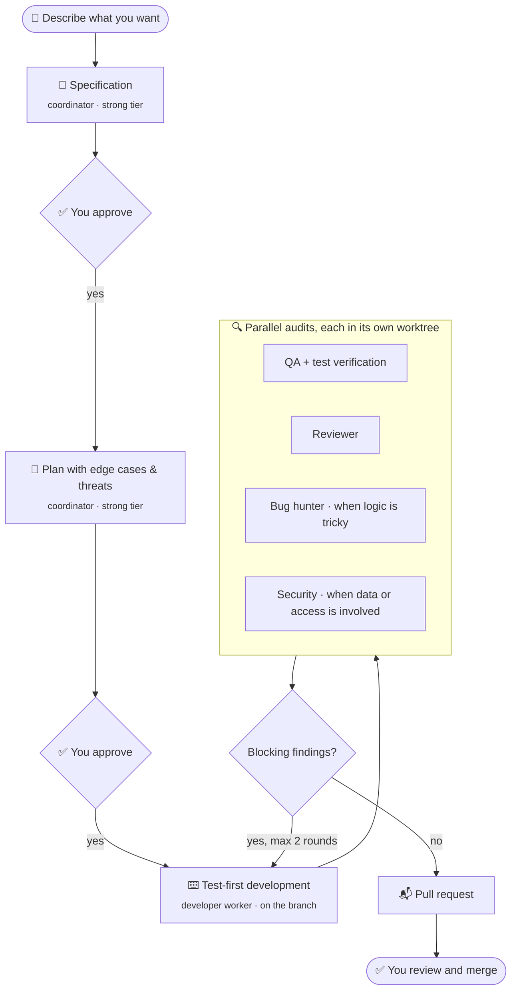

<div align="center">

# 🐟 Pilotfish

**A spec-driven, multi-model AI development team for [Orca](https://www.onorca.dev).**

You approve the spec and the plan. A crew of agents builds it test-first, audits it, and opens a pull request you merge.
Every role runs on the model *you* choose — with automatic fallbacks when one runs out.

[](https://github.com/davidgarcia11/pilotfish/actions/workflows/validar.yml)


**English** · [Español](README.es.md)

</div>

---

## Why Pilotfish?

Coding agents are fast, but left alone they skip tests, drift from what you asked, and sign their commits. Running several agents in parallel makes it worse: who plans, who reviews, and what happens when your plan runs out of usage halfway through?

Pilotfish gives your agents a **process**, a **team structure**, and **guardrails that live in your repository** — so the result looks like the work of a disciplined senior team, whatever models you use.

> The pilot fish swims alongside the orca. Pilotfish swims alongside [Orca](https://www.onorca.dev), the agent development environment it runs on.

## ✨ Features

| | |
|---|---|
| 📝 **Spec-driven** | Nothing gets coded until you approve a specification and a plan with edge cases and threats. |
| 🧪 **Test-first, verified** | Every task ships with a test that was seen failing first. QA then breaks critical code on purpose to prove the tests catch it. |
| 👥 **A real team** | Coordinator, developer, QA, reviewer, bug hunter and security auditor — each with its own playbook. |
| 🎛️ **Bring your own models** | Choose the model for each role in one config file. Mix Claude, Codex, DeepSeek, GLM or anything Orca can launch. |
| 🔁 **Automatic fallbacks** | A model out of usage? The role moves to the next one in its list — or pauses, if you'd rather not downgrade. |
| 🧭 **Cross-provider review** | The reviewer prefers a different provider than the developer, so it catches different mistakes. |
| 🌳 **Parallel by design** | Auditors work in isolated worktrees; each worktree gets its own databases and ports. |
| 🛡️ **Guardrails in the repo** | Git hooks and CI block secrets, enforce conventional commits and reject AI attribution — for every agent, even if it skips the hooks. |
| 🤝 **Handoff** | All state lives in the repo, in Orca and in the worktree status. Any agent can say "continue" and pick up where another left off. |
| 🙋 **You stay in charge** | Approvals in chat (or from your phone with Orca Mobile). Merges are always yours. |

## 🔄 How it works



- **The coordinator** is the agent you talk to in an Orca task. It writes the spec and the plan, dispatches work through Orca's orchestration, and checks every result against evidence.
- **Workers** are agents Orca launches with the model your config picks. Each brief carries the role's full playbook, so any provider can play any role.
- **Audits run by risk:** QA and the reviewer always; the bug hunter and the security auditor only when the change calls for them.

## 🚀 Quick start

**Requirements** on the machine where your agents run (for example, an always-on Orca server):

- [Orca](https://www.onorca.dev) with its `orchestration` and `orca-cli` skills
- At least one agent logged in (for example [Claude Code](https://docs.claude.com/en/docs/claude-code))
- `git`, `python3` 3.11+, [`mise`](https://mise.jdx.dev), and Docker for projects with local services

**Install:**

```bash
gh repo clone davidgarcia11/pilotfish ~/pilotfish
~/pilotfish/bin/pilotfish install
```

This links the `pilotfish` skill for your agents (`~/.claude/skills`, `~/.agents/skills`), puts the `pilotfish` command in `~/.local/bin`, lets Claude Code read (not edit) the Pilotfish folder without asking, and shows which model will play each role.

**Use it:** open a task in Orca with your coordinator agent and just say what you want.

| Say something like… | Workflow |
|---|---|
| "Create an app that…" | [New project](skills/pilotfish/flujos/nuevo-proyecto.md) |
| "Bring this project up to standard" | [Adopt a project](skills/pilotfish/flujos/adaptar-proyecto.md) |
| "Update this project with Pilotfish's latest" | [Update a project](skills/pilotfish/flujos/actualizar-proyecto.md) |
| "Add…", "change…" | [Feature](skills/pilotfish/flujos/funcionalidad.md) |
| "X is broken…" | [Fix](skills/pilotfish/flujos/arreglo.md) |
| "Continue" | Handoff: resume a workflow another coordinator left halfway |

**Update:** `pilotfish update`.

## 🎛️ Choosing models

Roles ask for a **tier**; each tier is a list of models in order of preference ([`team.toml`](team.toml)):

```toml
[tiers]
strong   = ["claude:opus", "codex:gpt-6-astra", "opencode:deepseek/deepseek-v4-pro", "opencode:zai-coding-plan/glm-5.3"]
standard = ["claude:sonnet", "codex:gpt-6-sol", "opencode:deepseek/deepseek-v4-pro", "opencode:zai-coding-plan/glm-5.3"]
budget   = ["opencode:deepseek/deepseek-flash", "opencode:zai-coding-plan/glm-5.3-flash", "claude:sonnet"]

[roles]
plan       = "strong"     # coordinator: spec and plan
coordinate = "standard"   # coordinator: dispatch, verify, open the PR
developer  = "budget"
qa         = "budget"
reviewer   = "standard"
bug_hunter = "strong"
security   = "strong"

[rules]
when_tier_exhausted = "pause"   # or "downgrade"
reviewer_different_provider = true
```

- **The first available model wins.** A model is skipped if its agent isn't installed, isn't logged in, doesn't offer that model, or ran out of usage. Install Codex tomorrow and it joins automatically — it's already on the lists.
- **Your overrides** live in `~/.config/pilotfish/team.toml` (`pilotfish config` creates it). Add only what you change; updates never touch it.
- **A role can have its own list** instead of a tier, e.g. `security = ["claude:opus", "codex:gpt-6-astra"]`.
- **One-off changes:** tell the coordinator "use Codex for security on this one" and it applies just to that task.

See what each role will use right now:

```console
$ pilotfish agents
Role         Tier      Uses                                       Fallbacks
plan         strong    claude:opus                                —
coordinate   standard  claude:sonnet                              —
developer    budget    opencode:deepseek/deepseek-flash           claude:sonnet
qa           budget    opencode:deepseek/deepseek-flash           claude:sonnet
reviewer     standard  claude:sonnet                              —
bug_hunter   strong    claude:opus                                —
security     strong    claude:opus                                —
```

## 🔁 Fallbacks and handoff

- **Workers:** if a worker stops because its model hit a usage limit, the coordinator re-resolves the team without it (`pilotfish agents --without claude`) and relaunches the same brief on the next model.
- **Coordinator:** a model that is out of usage can't hand anything off, so everything is written down as it happens: spec, plan and tasks in the repo, runs in Orca's orchestration, and a status line on the worktree. Open another agent in the same task, say **"continue"**, and it resumes from that point.

## 🧩 Per-project setup in Orca

In **Settings → Repository**:

- **Base ref:** `origin/main`
- **Setup script:** `mise trust && mise install && mise run setup`
- **On worktree removal** (if available): `scripts/entorno-worktree.sh --borrar`

Projects with a database get their own databases and ports per worktree (`.env.worktree`), so parallel tasks never collide.

## 📁 What Pilotfish adds to a project

```text
my-project/
├── .githooks/          secrets, commit format, AI attribution          ┐
├── .github/            CI (check + commit verification), PR template   │
├── scripts/            comprobar-commits.sh, entorno-worktree.sh       │ committed
├── docs/               architecture, ADRs, specs, runbook              │
├── mise.toml           pinned tools and tasks                          ┘
├── AGENTS.md           project rules for any agent                     ┐
├── CLAUDE.md           @AGENTS.md                                      │ local only
├── .claude/            permissions and a no-commit-on-main hook        │
└── .worktreeinclude    what Orca copies into each worktree             ┘
```

## 🗂️ Repository layout

```text
pilotfish/
├── team.toml           default tiers, roles and rules
├── bin/pilotfish       install · update · agents · config · path · scaffold
├── lib/team.py         picks the model for each role
├── skills/pilotfish/
│   ├── SKILL.md        the coordinator: team, orchestration, fallbacks, handoff
│   ├── flujos/         workflows: new, adopt, update, feature, fix
│   ├── papeles/        full playbook for each worker role
│   ├── guias/          technical design, stack, architecture, security
│   └── plantillas/     spec, plan and task templates
├── plantillas/         what `pilotfish scaffold` adds to a project
└── tests/probar.sh
```

## ❓ FAQ

<details>
<summary><b>Do I need Claude?</b></summary>

No. Any agent Orca can launch works for any role. The defaults favor Claude for planning and audits, but you can point every tier at other models.
</details>

<details>
<summary><b>Does it work without Orca?</b></summary>

Not today. Pilotfish relies on Orca's orchestration (workers, worktrees and handoff). The repository guardrails — hooks, CI checks, templates — work anywhere.
</details>

<details>
<summary><b>Will my commits say they were written by AI?</b></summary>

No. A `commit-msg` hook strips co-author trailers and "Generated with" lines, and CI rejects any commit that still carries AI attribution — even if an agent skipped the hooks.
</details>

<details>
<summary><b>What language does it speak?</b></summary>

The coordinator talks to you in your language and writes specs, commits and PRs in your project's language. The internal playbooks and templates are currently written in Spanish; English versions are on the roadmap.
</details>

## 🗺️ Roadmap

- English playbooks and templates
- Tested presets for Codex, GLM and Kimi
- Automatic coordinator handoff before hitting a usage limit
- More stacks in the project templates

## 🤝 Contributing

Issues and pull requests are welcome. Before opening a PR, run:

```bash
bash tests/probar.sh
```

## 📄 License

No license has been chosen yet, so all rights are reserved for now.

---

<sub>Pilotfish is an independent project. It is not affiliated with or endorsed by Orca, Anthropic, OpenAI, DeepSeek, Z.ai or any other model provider.</sub>
