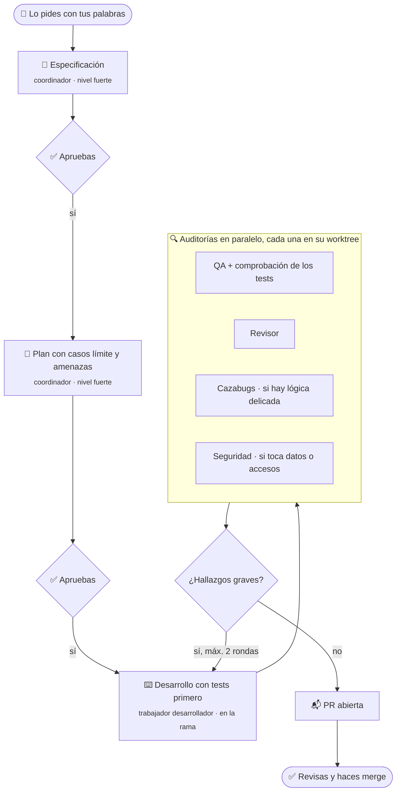

# Taller

Proceso de desarrollo profesional con un equipo de agentes en [Orca](https://www.onorca.dev): especificación y plan que apruebas tú, desarrollo con tests primero, auditorías según el riesgo y una PR que mergeas tú. Cada papel del equipo lo hace el modelo que tú elijas en un archivo de configuración, con reservas por si alguno se queda sin uso.

## Cómo funciona



- **El coordinador** es el agente con el que hablas en una tarea de Orca. Escribe la especificación y el plan, reparte el trabajo con la orquestación de Orca y comprueba cada resultado.
- **Los trabajadores** (desarrollador, QA, revisor, cazabugs y seguridad) son agentes que Orca lanza con el modelo que diga la configuración. Reciben en cada encargo sus instrucciones completas, así que da igual de qué proveedor sean.
- **Las protecciones viven en el repositorio de cada proyecto** y valen para cualquier agente: hooks de git (secretos, formato de commits y firmas de IA), el CI (que vuelve a comprobar los commits por si alguien se salta los hooks) y el merge, que siempre haces tú.

## Qué modelo hace cada papel

Lo decide [`equipo.toml`](equipo.toml). Cada papel pide un nivel, y cada nivel es una lista de modelos por orden de preferencia:

```toml
[niveles]
fuerte = ["claude:opus", "codex:gpt-6-astra", "opencode:zai-coding-plan/glm-5.3"]
medio  = ["claude:sonnet", "codex:gpt-6-sol", "opencode:zai-coding-plan/glm-5.3"]
barato = ["opencode:deepseek/deepseek-chat", "opencode:zai-coding-plan/glm-5.3-flash", "claude:sonnet"]

[papeles]
planificar = "fuerte"     # coordinador: especificación y plan
coordinar = "medio"       # coordinador: repartir, comprobar y abrir la PR
desarrollador = "barato"
qa = "barato"
revisor = "medio"
cazabugs = "fuerte"
seguridad = "fuerte"
```

- **Se usa el primero disponible.** Un modelo no está disponible si su agente no está instalado, no tiene la sesión iniciada o se ha quedado sin uso. Instalar un agente nuevo (por ejemplo Codex) basta para que entre: ya está en las listas.
- **Si a un papel no le queda nadie** en su nivel, se pausa y te avisa, o baja de nivel si pones `si_no_queda_nivel = "bajar"`.
- **El revisor** elige, si puede, un modelo de otro proveedor que el del desarrollador.
- **Tu configuración** va en `~/.config/taller/equipo.toml` (`taller config` la crea) y manda sobre la del repositorio. Pon solo lo que cambies. Al actualizar el taller nunca se pisa.

Para ver qué hará cada papel con lo que tienes instalado:

```bash
taller agentes
```

## Instalación

En la máquina donde corren los agentes (por ejemplo, el servidor de Orca), con `git`, `python3` 3.11 o superior, `mise` y Orca con las skills `orchestration` y `orca-cli`:

```bash
gh repo clone davidgarcia11/taller ~/taller
~/taller/bin/taller instalar
```

Instala la skill `taller` para los agentes de esa máquina (`~/.claude/skills` y `~/.agents/skills`) y el comando `taller` en `~/.local/bin`.

Para actualizar: `taller actualizar`.

## Uso

En una tarea de Orca, con el agente coordinador, dilo con tus palabras:

| Dices algo como… | Flujo |
|---|---|
| «Quiero crear una app para…» | [nuevo proyecto](skills/taller/flujos/nuevo-proyecto.md) |
| «Adapta este proyecto al estándar» | [adaptar proyecto](skills/taller/flujos/adaptar-proyecto.md) |
| «Pon al día este proyecto con el taller» | [actualizar proyecto](skills/taller/flujos/actualizar-proyecto.md) |
| «Quiero añadir…», «cambia…» | [funcionalidad](skills/taller/flujos/funcionalidad.md) |
| «Falla…», «no funciona…» | [arreglo](skills/taller/flujos/arreglo.md) |
| «Continúa» | relevo: sigue un flujo que dejó a medias otro coordinador |

### Si el coordinador se queda sin uso

Todo el estado está en el repositorio (especificación, plan, tareas y commits), en la orquestación de Orca y en el comentario del worktree. Abre otro agente en la misma tarea y dile «continúa»: lee ese estado y sigue desde donde se quedó.

### Configuración de Orca por proyecto

En Ajustes → Repositorio:

- Rama base: `origin/main`.
- Script de preparación: `mise trust && mise install && mise run setup`.
- Al borrar un worktree, si Orca lo permite: `scripts/entorno-worktree.sh --borrar`.

Con base de datos, cada worktree tiene sus propias bases y puertos (`.env.worktree`), así que puedes tener varias tareas en paralelo sin que se pisen.

## Qué queda en cada proyecto

```text
mi-proyecto/
├── .githooks/                 secretos, formato de commits, firmas de IA      ┐
├── .github/                   CI (check + comprobación de commits), PR        │
├── scripts/                   comprobar-commits.sh, entorno-worktree.sh       │ En git
├── docs/                      arquitectura, ADR, especificaciones, runbook    │
├── mise.toml                  herramientas fijadas y tareas                   ┘
├── AGENTS.md                  reglas del proyecto para cualquier agente       ┐
├── CLAUDE.md                  @AGENTS.md                                      │ Solo local
├── .claude/                   permisos y hook que bloquea commits en main     │
└── .worktreeinclude           lo que Orca copia a cada worktree               ┘
```

## Estructura del repositorio

```text
taller/
├── equipo.toml                niveles, papeles y reglas por defecto
├── bin/taller                 instalar, actualizar, agentes, config, ruta, base
├── lib/equipo.py              elige el modelo de cada papel
├── skills/taller/
│   ├── SKILL.md               el coordinador: equipo, orquestación, reservas y relevo
│   ├── flujos/                nuevo, adaptar, actualizar, funcionalidad, arreglo
│   ├── papeles/               instrucciones completas de cada trabajador
│   ├── guias/                 diseño técnico, stack, arquitectura, seguridad
│   └── plantillas/            spec, plan y tareas
├── plantillas/                lo que `taller base` pone en cada proyecto
└── tests/probar.sh
```

## Validar

```bash
bash tests/probar.sh
```
